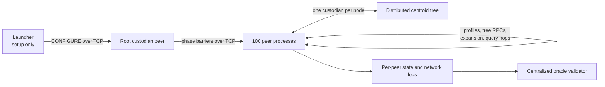

# Port-Based Decentralized Semantica v1

This package runs Semantica as isolated peer processes. Each peer binds an
operating-system-assigned TCP port, owns only its private shard, and performs all
peer and custodian interactions through length-prefixed MessagePack RPCs. The
launcher is limited to startup, membership configuration, waiting, and output
collection.

## Installation and source dependencies

From a clean clone, install the bounded runtime dependency set with:

```bash
python -m pip install -r requirements-decentralized.txt
```

For local test execution, use `requirements-decentralized-dev.txt`. The package
intentionally uses the repository's existing centralized implementation as its
independent validation oracle. Consequently, the source dependency closure for
this implementation includes `unified_retrieval_benchmark.py`,
`peer_graph_comparison.py`, `pubmedqa_overlay_benchmark.py`, and
`retrieval_benchmark.py`; these files must be committed together with the
`decentralized_semantica/` package.



## Commands

On DAS-6, the acceptance configuration uses the defaults:

```bash
python -m decentralized_semantica prepare \
  --output-dir /var/scratch/pmneague/Low_Coord_Semantic_DHT/decentralized_semantica/run_001/prepared

python -m decentralized_semantica run \
  --prepared-dir /var/scratch/pmneague/Low_Coord_Semantic_DHT/decentralized_semantica/run_001/prepared \
  --run-dir /var/scratch/pmneague/Low_Coord_Semantic_DHT/decentralized_semantica/run_001/run

python -m decentralized_semantica validate \
  --prepared-dir /var/scratch/pmneague/Low_Coord_Semantic_DHT/decentralized_semantica/run_001/prepared \
  --run-dir /var/scratch/pmneague/Low_Coord_Semantic_DHT/decentralized_semantica/run_001/run
```

Submit the complete prepare/run/validate workflow after syncing the source to
the login node:

```bash
scripts/submit_decentralized_semantica_100.sh \
  /var/scratch/pmneague/Low_Coord_Semantic_DHT/decentralized_semantica/run_001
```

The submission helper creates the scratch and Slurm log directories and checks
that Slurm node metadata is available. The job requests one regular 64-CPU node,
starts 100 peer processes, and pins BLAS/OpenMP libraries to one thread per
process.

## Outputs

The run directory contains the runtime membership and run manifests, one JSONL
network log and one MessagePack state file per peer, a canonical tree snapshot,
profile arrays and CSV metadata, contacts for every round, query paths and
results (one bounded MessagePack artifact per source peer), message/byte totals,
phase timings, and `validation_report.json`.

The validator first enforces protocol and graph invariants. Its default full
mode reconstructs the same 100-peer fixture with the existing unified benchmark,
runs the centralized query chain sequentially in the same peer order, and
compares fitted profiles, canonical leaf membership, split centers,
per-centroid contacts for rounds 0–20, exact hop sequences, exact per-hop and
merged document ordering, terminal reasons, and scores within the declared
float32 tolerance. `--structural-only` is available for handcrafted fixtures
that do not have a centralized embedding bundle.

## Deliberate v1 limits

Membership is static. A tree node has one rendezvous-selected custodian. TCP
failure or timeout aborts the run. Churn, custodian replication, reassignment,
malicious peers, recovery, and protected random links are outside this version.
