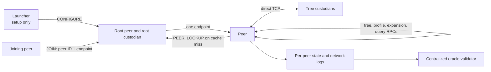

# Membership-Free Decentralized Semantica

This package runs Semantica as a network of isolated Python processes. Every
peer owns a private document shard, binds an operating-system-assigned TCP port,
and communicates with peers and tree custodians using length-prefixed
MessagePack RPCs.

Peers do not receive a global membership list. They learn one root bootstrap
endpoint out of band, register with that root, and resolve unknown peer IDs on
demand. Tree-node custodian assignments are pinned when nodes are created.

Two execution modes are supported:

- **Synchronous compatibility mode** starts a fixed experiment cohort in peer
  order and uses a peer-to-peer successor token for construction, round 0,
  expansion, querying, and export. This mode is intended to reproduce the
  centralized simulator exactly.
- **Active late-join mode** keeps the completed overlay online. A new process
  can join through the root using only `bootstrap.json` and its private shard.
  The newcomer is inserted and organized without rebuilding existing peers'
  contact tables.

## Requirements

- Python 3.11 or newer
- A machine that permits local TCP listeners
- Enough memory and process capacity for one process per initial peer
- The PubMedQA embedding bundle and seed-42 overlay for the published
  100-peer experiment

From the repository root:

```bash
python -m pip install -r requirements-decentralized.txt
```

Install the test dependency set when developing:

```bash
python -m pip install -r requirements-decentralized-dev.txt
```

The validator imports the repository's centralized implementation as an
independent oracle. Keep these files beside the package:

- `unified_retrieval_benchmark.py`
- `peer_graph_comparison.py`
- `pubmedqa_overlay_benchmark.py`
- `retrieval_benchmark.py`

## How the processes communicate



The launcher stages inputs, starts processes, publishes the root bootstrap,
waits for completion, and aggregates outputs. It does not build the tree,
select contacts, advance expansion rounds, or route queries.

## 1. Prepare private peer shards

The default paths target the PubMedQA data already staged on DAS-6:

```bash
export RUN_ROOT="$PWD/decentralized-run"
mkdir -p "$RUN_ROOT"

python -m decentralized_semantica prepare \
  --output-dir "$RUN_ROOT/prepared" \
  --peer-count 100 \
  --seed 42
```

For another installation, provide the two source locations explicitly:

```bash
python -m decentralized_semantica prepare \
  --output-dir "$RUN_ROOT/prepared" \
  --data-root /path/to/pubmedqa/embedding-bundle \
  --overlay-root /path/to/pubmedqa/overlay-cache \
  --peer-count 100 \
  --seed 42
```

Preparation creates one `shards/peer_XXXXX.npz` file per peer. The runtime
discovers peers from those private shard files; neither
`prepared_manifest.json` nor the later `bootstrap.json` contains a peer list.
`central_fixture.npz` is for the trusted validator and is never read by peer
processes.

## 2. Run deterministic synchronous mode

```bash
python -m decentralized_semantica run \
  --prepared-dir "$RUN_ROOT/prepared" \
  --run-dir "$RUN_ROOT/run" \
  --root-peer-id 0 \
  --rpc-timeout-seconds 30
```

Synchronous compatibility mode requires private shards for peer positions
`0..N-1`; the root must be the first peer. The launcher starts the root first,
waits for initialization, then starts every remaining process in order and
waits for each `JOIN` acknowledgment.

Each peer receives only its immediate successor's endpoint. A token moves
through that chain to serialize:

1. centroid insertion;
2. round-0 contact construction;
3. every expansion round;
4. sequential queries; and
5. state export.

The command returns after the peers export their state and shut down.

## 3. Validate a synchronous run

```bash
python -m decentralized_semantica validate \
  --prepared-dir "$RUN_ROOT/prepared" \
  --run-dir "$RUN_ROOT/run"
```

Full validation reconstructs the experiment with the centralized simulator and
compares profiles, centroid quotas, canonical tree contents, contacts for every
round, query paths, returned documents, terminal states, and float32 scores.

To also compare with a previous decentralized run:

```bash
python -m decentralized_semantica validate \
  --prepared-dir "$RUN_ROOT/prepared" \
  --run-dir "$RUN_ROOT/run" \
  --reference-run /path/to/reference/run
```

`--reference-run` requires bitwise-identical algorithmic state. Physical TCP
ports, custodian placement, and network totals are excluded because discovery
changes those values.

## 4. Keep an overlay active and join later

First prepare the initial cohort and a source containing the additional peer:

```bash
python -m decentralized_semantica prepare \
  --output-dir "$RUN_ROOT/prepared-100" \
  --peer-count 100 \
  --seed 42

python -m decentralized_semantica prepare \
  --output-dir "$RUN_ROOT/prepared-101" \
  --peer-count 101 \
  --seed 42
```

Start the initial overlay with `--keep-active`. The command must remain running
because it owns the initial peer processes:

```bash
python -m decentralized_semantica run \
  --prepared-dir "$RUN_ROOT/prepared-100" \
  --run-dir "$RUN_ROOT/run" \
  --root-peer-id 0 \
  --run-timeout-seconds 10800 \
  --keep-active \
  > "$RUN_ROOT/runner.json" &
RUNNER_PID=$!

until test -f "$RUN_ROOT/run/overlay_active.json"; do
  sleep 1
done
```

At this point `$RUN_ROOT/run/bootstrap.json` contains the protocol parameters,
epoch, root peer ID, and root TCP endpoint—but no membership list. Preserve the
initial state if you want the validator to prove that existing contacts remain
byte-identical:

```bash
mkdir -p "$RUN_ROOT/prejoin-run"
cp -a "$RUN_ROOT/run/state" "$RUN_ROOT/prejoin-run/state"
```

Start peer 100 as an independent process. The `join` command stays alive to
serve requests until the overlay is finalized:

```bash
python -m decentralized_semantica join \
  --bootstrap "$RUN_ROOT/run/bootstrap.json" \
  --peer-id 100 \
  --shard "$RUN_ROOT/prepared-101/shards/peer_00100.npz" \
  --run-dir "$RUN_ROOT/run" \
  > "$RUN_ROOT/peer-100.json" &
JOIN_PID=$!

until grep -q '"event": "active".*"peer_id": 100' \
  "$RUN_ROOT/run/join_events.jsonl"; do
  sleep 1
done
```

The root serializes late admissions. Peer 100 fits its profile, inserts its
centroids into the live tree, creates its own round-0 contacts, completes its
configured expansion rounds, and runs its query. Existing peers' contacts are
not rewritten.

When finished, export all state and shut down the overlay:

```bash
python -m decentralized_semantica finalize \
  --bootstrap "$RUN_ROOT/run/bootstrap.json"

wait "$RUNNER_PID"
wait "$JOIN_PID"
```

Validate the dynamic run structurally and verify that the original contact
tables did not change:

```bash
python -m decentralized_semantica validate \
  --prepared-dir "$RUN_ROOT/prepared-100" \
  --run-dir "$RUN_ROOT/run" \
  --structural-only \
  --prejoin-run "$RUN_ROOT/prejoin-run"
```

Add `--reference-run /path/to/reference/run` to require the initial 100 peers'
profiles, contacts, and query results to remain bitwise-identical to a previous
100-peer run. Equality is intentionally not required for peer 100 or the
post-join tree.

## Running on DAS-6 with Slurm

Run setup and submission on the login node, but execute the 100-process workload
through Slurm. The synchronous helper requests one 64-CPU node and pins BLAS and
OpenMP libraries to one thread per peer process:

```bash
scripts/submit_decentralized_semantica_100.sh \
  /var/scratch/$USER/decentralized_semantica/run_001
```

The standalone asynchronous acceptance harness prepares 100 initial peers,
starts peer 100 after `ACTIVE`, checks contact stability, and validates against a
reference run:

```bash
sbatch \
  --export=ALL,PROJECT_DIR="$PWD",REFERENCE_RUN=/path/to/reference/run \
  scripts/run_decentralized_semantica_async_acceptance.sbatch \
  /var/scratch/$USER/decentralized_semantica/late_join_001
```

## Output files

Important files under the run directory are:

| File | Purpose |
|---|---|
| `bootstrap.json` | Peer-list-free root bootstrap configuration |
| `overlay_active.json` | Signals that synchronous setup and queries finished |
| `join_events.jsonl` | Ordered registration and late-admission events |
| `discovered_peer_registry.json` | Final audit-only registry; never runtime input |
| `custodian_assignments.json` | Permanent node-to-custodian assignments |
| `state/peer_XXXXX.msgpack` | Private exported state for each peer |
| `logs/*.jsonl` | Every protocol send and receive |
| `tree_snapshot.msgpack` | Canonical tree snapshot |
| `centroid_profiles.npz` | Compact profile and centroid arrays |
| `contacts_rounds_0_20.msgpack` | Contacts for all configured rounds |
| `query_paths_results/` | Per-source query paths and results |
| `network_summary.json` | Message and byte totals by type |
| `validation_report.json` | Structural, oracle, reference, and stability results |

## Run the tests

The tests include framing and array validation, root discovery, duplicate join
rejection, endpoint caching, stable custody, ordered tokens, recursive splits,
contact-pending behavior, process-isolated TCP communication, exact centralized
parity, and a standalone late join:

```bash
python -m pytest -q tests/test_decentralized_semantica.py
```

## Current limits

- The root endpoint must be learned out of band and remain online.
- Current endpoints use `127.0.0.1`, so all peer processes must run on one host.
- There is one custodian per tree node and no reassignment or replication.
- Peer IDs and endpoints must be stable and unique.
- TCP failure or timeout aborts the run; recovery and churn are not implemented.
- Authentication and malicious-peer defenses are not implemented.
- A late join organizes only the newcomer. Existing peers can learn newcomers
  only through a later explicitly initiated expansion cycle.
- If too few peers exist to fill the configured degree, the newcomer remains
  tree-inserted and contact-pending until more peers become active.
